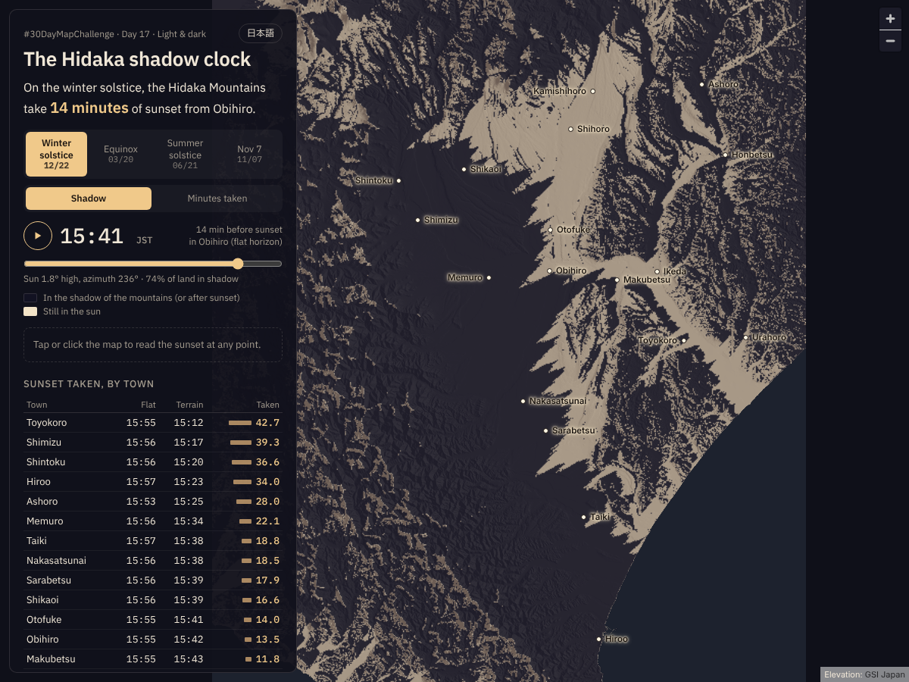

# The Hidaka shadow clock（日高山脈の影の時計）

#30DayMapChallenge 2026 Day 17「Light & dark」の作品です。

日付と時刻から実際の太陽の位置を計算し、日高山脈の影が十勝平野へ伸びていく様子を、光と影だけで描きました。冬至の夕方、山に隠れて日没が何分早く来るかを、十勝の地点ごとに示します。

> On the winter solstice, the Hidaka Mountains take 14 minutes of sunset from Obihiro.
> 冬至の日、日高山脈は帯広から日没を14分奪う。

**公開URL:** https://shinyanakashima.github.io/30daymapchallenge-2026day17-hidaka-shadow/



## 画面の使い方

- 日付（冬至 12/22・春分 3/20・夏至 6/21・11月7日）を選び、再生ボタンかスライダーで、帯広の日没（平らな地平線）までの90分間の影の動きを見ます。
- 「Minutes taken / 奪われた分数」に切り替えると、地形に奪われた日没の分数の地図になります。
- 地図をクリックすると、その地点の平らな地平線での日没時刻、地形による日没時刻、差の分数を表示します。
- 右上のボタンで英語と日本語を切り替えます。端末が「視差効果を減らす（動きを減らす）」設定のときは自動再生しません。
- URLパラメータ: `?date=winter|equinox|summer|today`、`&t=0〜90`（フレーム番号）、`&view=taken`、`&lang=ja`

## 冬至（2026年12月22日）の主な町の値

各役場に最も近い計算点の値です（時刻は日本時間）。

| 町 | 平らな地平線での日没 | 地形による日没 | 奪われた分数 |
|---|---|---|---|
| 豊頃 (Toyokoro) | 15:55 | 15:12 | 42.7 |
| 清水 (Shimizu) | 15:56 | 15:17 | 39.3 |
| 新得 (Shintoku) | 15:56 | 15:20 | 36.6 |
| 広尾 (Hiroo) | 15:57 | 15:23 | 34.0 |
| 足寄 (Ashoro) | 15:53 | 15:25 | 28.0 |
| 芽室 (Memuro) | 15:56 | 15:34 | 22.1 |
| 大樹 (Taiki) | 15:57 | 15:38 | 18.8 |
| 中札内 (Nakasatsunai) | 15:56 | 15:38 | 18.5 |
| 更別 (Sarabetsu) | 15:56 | 15:39 | 17.9 |
| 鹿追 (Shikaoi) | 15:56 | 15:39 | 16.6 |
| 音更 (Otofuke) | 15:55 | 15:41 | 14.0 |
| 帯広 (Obihiro) | 15:55 | 15:42 | 13.5 |
| 幕別 (Makubetsu) | 15:55 | 15:43 | 11.8 |
| 浦幌 (Urahoro) | 15:54 | 15:44 | 9.6 |
| 本別 (Honbetsu) | 15:53 | 15:44 | 9.3 |
| 士幌 (Shihoro) | 15:54 | 15:45 | 9.1 |
| 池田 (Ikeda) | 15:54 | 15:46 | 8.9 |
| 上士幌 (Kamishihoro) | 15:54 | 15:48 | 6.1 |

## 計算方法

前処理はすべて Python（`scripts/`）で行い、結果を静的なファイル（`site/data/`）にしています。

1. **標高**: 国土地理院の標高タイル（DEM10B、`dem_png`）をズーム12で取得し、約28m間隔のグリッドにします。地平線の計算には、地図の範囲（東経142.4〜143.8度、北緯42.2〜43.4度）より広い東経141.6〜143.85度、北緯41.9〜43.9度を使い、夕張山地や大雪山系・十勝岳連峰も遮る地形として含めます。海は標高0mとしています。
2. **地平線の高さ**: 地図の範囲に約195m間隔（28mグリッドの7画素ごと）で計算点を置き、方位180〜310度を1度ごとに、最大150km先まで28mの標高グリッドを双一次補間でたどります（7km以遠は距離の0.4%ずつ間隔を広げる）。地球の丸みと大気差は、見かけの落ち込み d²(1−k)/(2R)（k = 0.13、R = 6,371km）で補正します。視点の高さは地上1.5m。numba で実装しています（`horizon_kernel`）。
3. **太陽の位置**: pvlib（NREL SPA）で、計算範囲を覆う8×8の格子点について20秒ごとに求め、各計算点へ双一次補間します。見かけの高さは pvlib の標準大気（気圧1013.25hPa、気温12℃）での大気差を含みます。
4. **平らな地平線での日没**: 太陽の中心の真の高さが −0.833度になる時刻。
5. **地形による日没**: 平らな地平線での日没より前で、太陽の上端（見かけの高さ + 0.267度）がその方角の地平線の高さより上にある最後の時刻。方位は1度ごとの値を線形補間します。
6. **山に奪われた分数**: 4. − 5.。地平線が平らな地平線より低い場所（山頂など）では0分とします。11:30以降に直射日光が当たらない地点は別扱いにしています。
7. **影の画像**: 4つの日付それぞれ、帯広の平らな地平線での日没前90分を1分ごとに、太陽が見えない（地形の陰、または日没後）範囲を2値のPNGにしています（`site/data/frames/`）。

日付は、冬至・春分・夏至を2026年の日本時間の日付、「今日」を作業日の2026年11月7日としています。

## 注記

- 地形だけで計算しており、雲、建物、木は考慮していません。
- 標高データの間隔は約28m（国土地理院 DEM10B、ズーム12）、結果の間隔は約195m、陰影図は約85mです。
- 大気差の係数 0.13、地球半径 6,371km で地球の丸みを補正しています。
- 計算した方位は180〜310度（1度ごと）、距離は最大150kmです。標高データの範囲（東経141.6〜143.85度、北緯41.9〜43.9度）の外の地形は含みません。
- 太陽の大気差は標準大気で計算しています。冬の低温時は大気差がやや大きくなり、実際の日没はわずかに遅くなります。

## データの出典

- 標高: 国土地理院 標高タイル（DEM10B）https://maps.gsi.go.jp/development/ichiran.html
- 太陽の位置: [pvlib python](https://pvlib-python.readthedocs.io/)
- 地図の表示: [MapLibre GL JS](https://maplibre.org/)

## 再現手順

```sh
pip install -r requirements.txt
cd scripts
python fetch_dem.py   # 標高タイル858枚を取得して data/work/dem.npy に結合
python compute.py     # 地平線・日没・影の画像を site/data/ に出力（4コアで約3分）
cd ..
python -m http.server 8000 -d site
```

表示の確認（Playwright）:

```sh
node scripts/check_site.mjs http://localhost:8000/
```

コンソールエラーと404が無いことを確かめ、`docs/screenshot.png`（1200×900、冬至・帯広の日没14分前）を書き出します。

`main` への push で GitHub Actions が `site/` を GitHub Pages に公開します（`.github/workflows/pages.yml`）。

## ライセンス

コードは MIT License。標高データは国土地理院のコンテンツ利用規約に従います。
